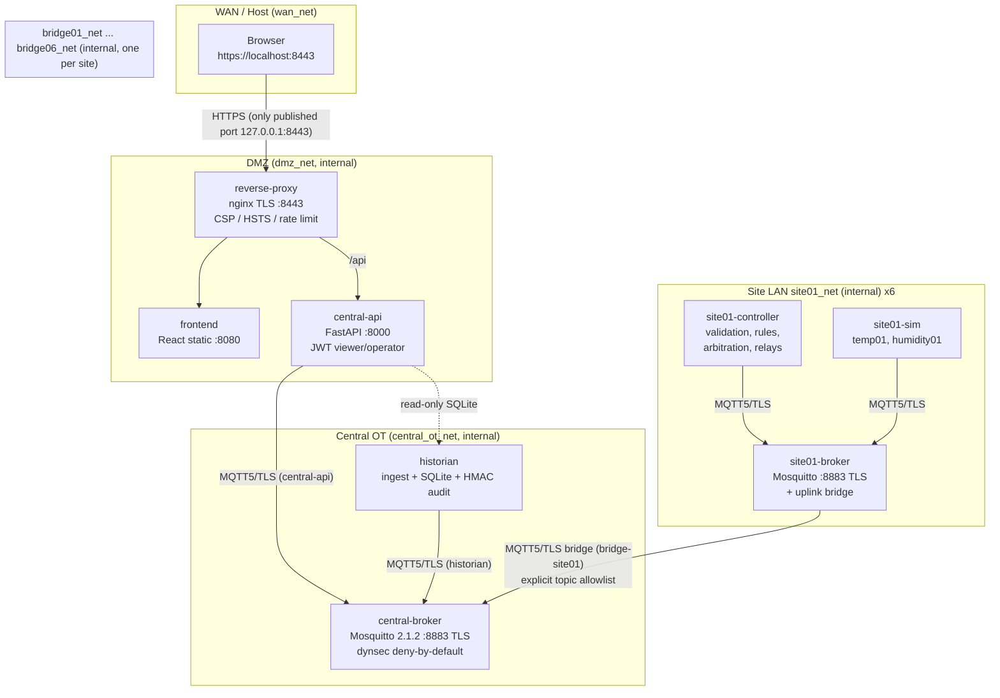
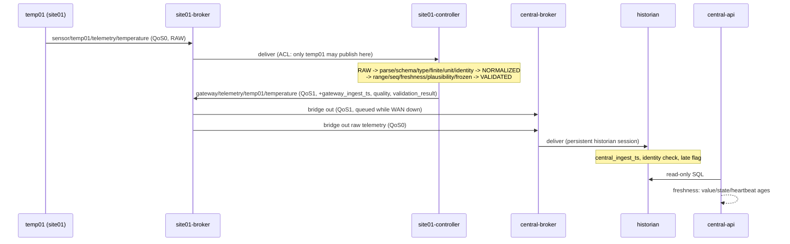
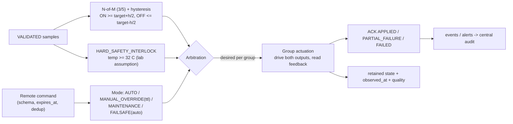

# Architecture - Secure Orchid IoT Control Platform (V2.2)

This document describes the implemented system. The V2.2 specification is the baseline; every
place where the implementation had to make a concrete choice the spec left open is marked
**[impl choice]**.

## 1. Zones and Docker networks

| Network | Members | Internet / host |
|---|---|---|
| `wan_net` | reverse-proxy | host port `127.0.0.1:8443` only |
| `dmz_net` | reverse-proxy, frontend, central-api | internal |
| `central_ot_net` | central-api, central-broker, historian (+ `lab-probe` in test profile) | internal |
| `bridgeNN_net` x6 | central-broker, siteNN-broker | internal |
| `siteNN_net` x6 | siteNN-broker, siteNN-controller, siteNN-sim (+ `lab-probe` on site01/02 in test profile) | internal |

Consequences (verified by G04/G09): no MQTT port is reachable from the host; a site LAN cannot
resolve or reach another site's broker or the central OT network; each site broker reaches
central only over its own bridge network. Compose is generated from `config/platform.yaml` by
`scripts/render_compose.py` (24 services, 15 networks) **[impl choice]**.

## 2. Components

| Component | Code | Responsibility |
|---|---|---|
| Field simulator | `services/orchid/site_service/simulator.py` | temp01 + humidity01 as separate MQTT principals; per-site profile; fault injection via loopback-only HTTP |
| Site controller | `site_service/controller.py` (I/O) + `engine.py` (pure logic) | validation pipeline, N-of-M + hysteresis, mode arbitration, group actuation, ACK, retained state, heartbeat/LWT, events/alerts |
| Local actuators | `site_service/actuators.py` | fans/dehumidifiers modeled as controller relay outputs with feedback (like a PLC DO/DI) **[impl choice]** |
| Site broker | `mosquitto/site-template/` | local TLS broker, dynsec, uplink bridge (MQTT5, verified TLS, bounded session) |
| Central broker | `mosquitto/central/` | TLS broker, dynsec, `$SYS` log to topic |
| Historian | `historian/{main,ingest,db}.py` | persistent bounded session, two-lane queue, untrusted-input pipeline, SQLite, HMAC chain |
| Central API | `central_api/*` | AuthN/AuthZ, freshness-aware read models, command publishing with MQTT expiry |
| Frontend | `services/frontend/` | React dashboard; text-only rendering of device data |
| Reverse proxy | `services/reverse-proxy/nginx.conf` | TLS edge, CSP, HSTS, login rate limit |

## 3. Data plane (sensor -> dashboard)

Only **VALIDATED** samples enter the AUTO rule window. Historical (store-and-forward) data is
stored centrally with `late=1` and never reaches any control loop (control is local).

## 4. Control plane (decision -> group command -> ACK -> observed state)

Priority: `HARD_SAFETY_INTERLOCK > FAILSAFE > MAINTENANCE > MANUAL_OVERRIDE > AUTO_RULE`.
A remote group command received in AUTO enters MANUAL_OVERRIDE for that group with operator,
reason, created_at and expires_at (TTL from config) **[impl choice]**; in MAINTENANCE/FAILSAFE it
is REJECTED, and a remote OFF for the fan group is REJECTED while the interlock is active.

## 5. Trust boundaries

| ID | Boundary | Control |
|---|---|---|
| TB1 | Host/WAN -> DMZ | TLS (lab CA), CSP, HSTS, nginx rate limits, JWT, RBAC |
| TB2 | DMZ -> Central OT | central-api may only publish `+/control/+/command` and `central/audit` |
| TB3 | Site -> Central (bridge) | per-site bridge identity; ACL = concrete registered topics of that site only |
| TB4 | Central -> Site | only `orchid/v1/<site>/control/+/command` crosses inbound |
| TB5 | Field device -> site broker | per-device identity bound to its client id; ACL = its own telemetry topic only |
| TB6 | Payload content | every payload is untrusted until it passes its own trust gate (telemetry, command, event) |
| TB7 | Fault/status interface | loopback-only HTTP inside each container; never on any network |

## 6. Topic flow (summary - full contract in docs/MQTT_CONTRACT.md)

| Direction | Topics |
|---|---|
| device -> site | `orchid/v1/{site}/sensor/{device}/telemetry/{metric}` |
| controller -> site | `gateway/telemetry/{device}/{metric}`, `actuator/{device}/state`, `control/{group}/ack`, `gateway/heartbeat`, `alerts`, `events` |
| site -> central (bridge out) | the 7 patterns above for that site only (never `#`) + bridge notification `gateway/bridge` |
| central -> site (bridge in) | `orchid/v1/{site}/control/{fan_group,dehumidifier_group,mode}/command` |
| central-api -> central | `control/+/command`, `orchid/v1/central/audit` |

## 7. Failure behaviour

| Failure | Behaviour (verified gate) |
|---|---|
| Central broker down / WAN cut | site AUTO control continues (G22); QoS1 data queued in site broker and delivered on recovery (G23) |
| Historian / logging down | control unaffected (G29); historian catches up via persistent session |
| Controller frozen/killed | dashboard shows UNKNOWN/OFFLINE and STALE states, never the retained value as fresh (G24) |
| Sensor invalid/stale/spike/frozen | rejected for control (G11-G13); sustained loss -> FAILSAFE outputs |
| Actuator member fault | PARTIAL_FAILURE ACK, CRITICAL alert, site DEGRADED (G16) |
