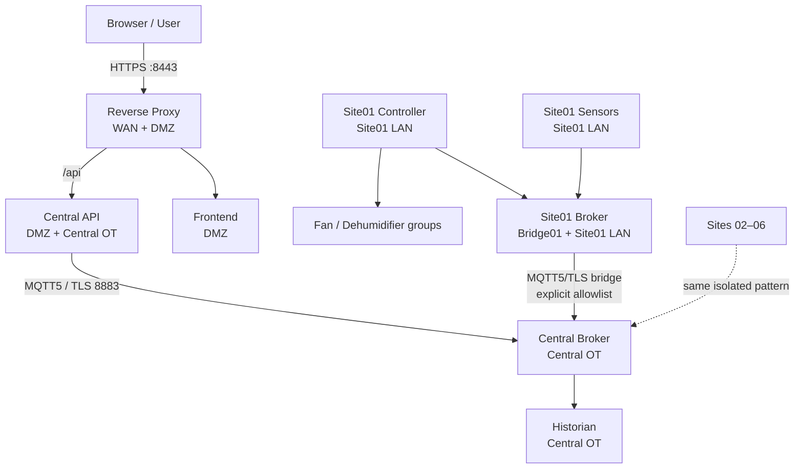
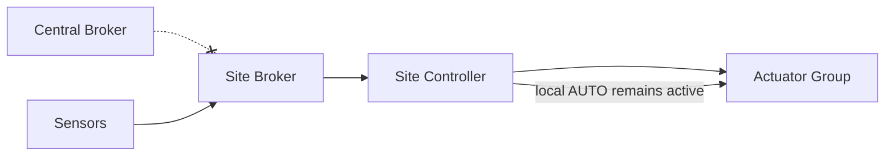

# Assignment #4 — Network & MQTT Security Report Guide

This is the security-course view of the Secure Orchid IoT Control Platform. The dashboard is supporting evidence; the primary report narrative is network/MQTT security.

## 1. Security-first architecture



Host exposure:
- `127.0.0.1:8443` only;
- no MQTT 1883/8883 host publication;
- MQTT traffic remains inside the 15 isolated Docker networks.

## 2. Trust boundaries

| Boundary | Risk | Control |
|---|---|---|
| Host/WAN -> DMZ | Web abuse / MITM | HTTPS, JWT/RBAC, CSP/HSTS, rate limiting |
| DMZ -> Central OT | Web tier directly controlling OT | Central API capability boundary + MQTT ACL |
| Site <-> Central | cross-site lateral movement | per-site bridge identity + explicit topic allowlist; never bridge `#` |
| Device -> Site Broker | principal spoofing / cross-topic publish | unique credential + fixed client-id + default-deny dynsec ACL |
| Payload content | forged/replayed/stale values | schema/type/range/seq/freshness/plausibility validation |

## 3. Secure MQTT flow

```mermaid
sequenceDiagram
  participant S as Sensor
  participant SB as Site Broker
  participant C as Site Controller
  participant CB as Central Broker
  participant H as Historian
  participant API as Central API
  participant A as Actuator Group

  S->>SB: QoS0 raw telemetry
  SB->>C: authorized topic only
  Note over C: RAW -> NORMALIZED -> VALIDATED
  C->>SB: QoS1 validated telemetry/state
  SB->>CB: MQTT5/TLS bridge; allowlist only
  CB->>H: central subscription / audit ingest

  API->>CB: QoS1 group command + Message Expiry
  CB->>SB: site-scoped command only
  SB->>C: command
  Note over C: expires_at + dedup + arbitration + safety
  C->>A: drive both members + read feedback
  C->>SB: ACK + observed state
  SB->>CB: bridge ACK/state
  CB->>H: audit/history
```

## 4. Authentication and authorization

- Mosquitto Dynamic Security, anonymous disabled.
- Unique production principal per device/controller/bridge/service.
- Production principal bound to a fixed MQTT client-id.
- Default deny for publish send, publish receive, subscribe and unsubscribe.
- Cross-site publish/subscribe is denied.
- Bridge topics are explicit; `#` is never bridged.
- MQTT uses TLS 1.2+ with hostname/SAN verification.

## 5. Command freshness and safety

- MQTT 5 Message Expiry prevents resurrection of expired queued commands.
- Application `expires_at` is checked again by the site controller.
- `command_id` provides dedup/idempotency.
- Authority priority: `HARD_SAFETY_INTERLOCK > FAILSAFE > MAINTENANCE > MANUAL_OVERRIDE > AUTO_RULE`.

## 6. Failure isolation



During central/WAN outage:
- site AUTO control continues;
- QoS1 bridge data queues locally;
- queued data catches up after recovery;
- central visibility/remote control is degraded, but local control is not stopped.

## 7. STRIDE evidence focus

| STRIDE | Example | Main control |
|---|---|---|
| Spoofing | wrong client-id / cross-site identity | unique credential + fixed client-id + ACL |
| Tampering | replayed telemetry / stale command | validation + sequence/freshness + Message Expiry |
| Repudiation | who issued a command? | JWT identity + command_id + server-bound audit |
| Information Disclosure | secret leakage / open MQTT port | gitignored file secrets + no host MQTT listener + secret scan |
| DoS | packet/log/queue flood | broker/application limits + bounded queues + rate limiting |
| Elevation | viewer writes / site reaches another site | RBAC + default-deny dynsec + network segmentation |

## 8. Physical deployment evidence

The final report should include one or two photographs of the Seeed Studio / NVIDIA Tegra ARM64 host. The photo should prove deployment, not imply unimplemented physical I/O.

Recommended:
1. Seeed device + display showing `docker compose ps` or the Dashboard.
2. Seeed device + terminal output from `scripts/report_network_evidence.sh`.
3. Optional: device + six-site Overview.

The current sensors and actuators are software simulators / relay models; the report does not claim GPIO-connected physical fans or dehumidifiers.

## 9. Evidence command

```bash
bash scripts/report_network_evidence.sh
```

This prints host/runtime, service health, Orchid network count, host port bindings, sample network membership, and API health. It intentionally does not print credentials or private keys.
